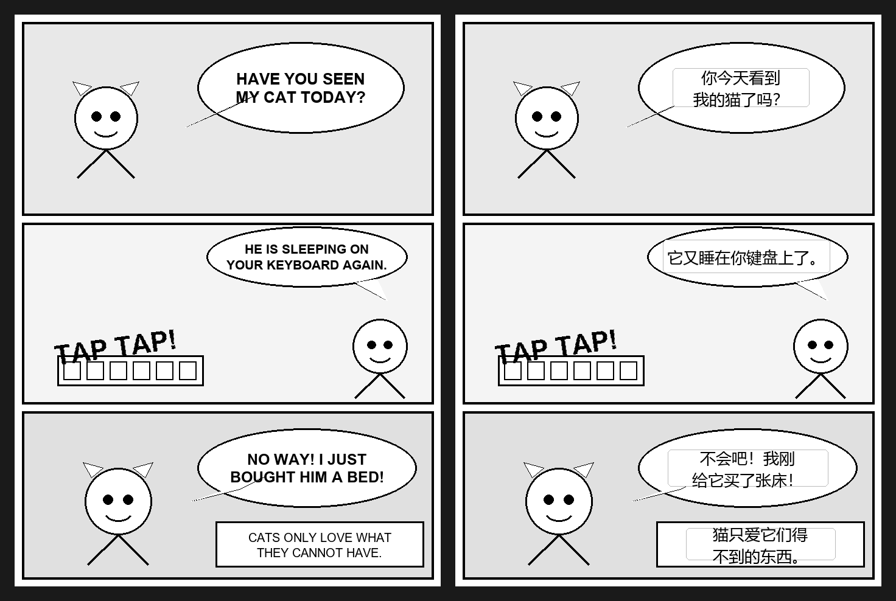
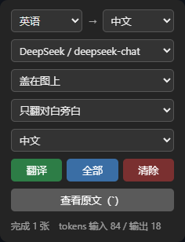

# Manga-Overlay-Translator

[简体中文](README.md) · **English**

[](https://greasyfork.org/en/scripts/588293)
[](LICENSE)

An OCR translator for web manga. A Tampermonkey userscript grabs images from the
page, sends them to a local Python service that recognises text positions and
content with PaddleOCR, calls an OpenAI-compatible LLM to translate, and overlays
the translation back onto the original image.

Meant as on-the-fly reading assistance for Japanese, Korean, English and Spanish
manga pages. It aims to be "good enough to read," not a polished official
localization.

> The backend listens on `127.0.0.1` only. Your API key stays in the local
> `server/.env` and is never written into the userscript or page context.

## Preview

**Before / after** (left: original English page; right: real pipeline overlay output):



The comic page is from Winsor McCay's *Little Nemo in Slumberland* (1906,
**public domain**, via Wikimedia Commons). The right side is generated from the
coordinates and translations the backend actually returns, with no manual
touch-up — what you see is the real output, including how the LLM corrects
handwriting OCR errors from context.

### Control panel



Top to bottom: source and target language, LLM model, display mode, translation
scope, and UI language. The panel also shows how many images were processed and
the token usage for the current run.

## Quick start (5 minutes)

1. Clone and install the backend:

   ```powershell
   git clone https://github.com/Yuff1010/Manga-Overlay-Translator.git
   cd Manga-Overlay-Translator\server
   python -m venv .venv
   .\.venv\Scripts\Activate.ps1
   python -m pip install --upgrade pip
   python -m pip install -r requirements.txt
   copy .env.example .env
   ```

   On macOS / Linux, activate with `source .venv/bin/activate` and copy the
   config with `cp .env.example .env`.

2. Edit `server/.env` and fill in at least `LLM_BASE_URL`, `LLM_API_KEY` and `LLM_MODEL`.
3. Start the service from the `server/` directory:

   ```powershell
   python main.py
   ```

   Open `http://127.0.0.1:8765/ping` — `{"ok": true}` means the backend is ready.

4. Install Tampermonkey, create a new script, and paste the full contents of
   [`userscript/ocr-translator.user.js`](userscript/ocr-translator.user.js).
5. Open a manga page you are entitled to access, choose "Open translator panel"
   from the Tampermonkey menu, pick your languages and model, then click
   "Translate" or "All".

The rest of this document covers full installation, panel usage, API fields, and
GPU / bubble-enhancement configuration.

## Features

- Handles ``, `<canvas>`, CSS background images, and lazy-loaded images.
- Scans images inside shadow DOM and same-origin iframes.
- On-demand translation: translates images as you scroll to them.
- Whole-page translation: processes every manga image found on the current page.
- Source language: auto-detect, Japanese, Korean, English, Spanish, Chinese.
- Target language: Chinese, English, Japanese, Korean.
- Language and model preferences are remembered per domain: each site recalls its
  last choice (first visit falls back to the global default). Display preferences
  (mode, scope, font size, UI language) are shared globally.
- Switch LLM provider and model from the panel, or type a model name by hand.
- The panel shows cumulative input / output tokens for the current run.
- OCR text boxes are returned in original-image coordinates; the frontend scales
  the overlay to the displayed image size.
- Two display modes: overlay on the original position (following the image every
  frame), or a plain-text list inserted below the image.
- Instant switch between "dialogue & narration only" and "all text" — no re-OCR,
  no re-translation.
- Panel UI in Chinese, English, Japanese, Korean and Spanish; first run follows
  the browser language.
- Hover a block to see the OCR original; click to hide it briefly and view the artwork.
- Very tall webtoon strips are tiled automatically to avoid losing text to downscaling.
- The backend keeps an OCR instance pool for concurrent frontend requests.

## Project structure

```text
Manga-Overlay-Translator/
├─ README.md
├─ docs/images/                   # original demo images for the README
├─ server/
│  ├─ main.py                     # FastAPI entry point
│  ├─ ocr.py                      # OCR, tiling and text-block merging
│  ├─ translator.py               # LLM translation and dialogue classification
│  ├─ bubble.py                   # optional speech-bubble segmentation
│  ├─ requirements.txt            # core dependencies
│  ├─ requirements-bubble.txt     # optional bubble-enhancement dependencies
│  └─ .env.example                # environment variable template
└─ userscript/
   └─ ocr-translator.user.js
```

## How it works

```text
Manga image on the page
    │
    │ userscript scans, grabs, converts to a data URL
    ▼
Local service http://127.0.0.1:8765
    │
    ├─ PaddleOCR: text and coordinates
    ├─ LLM API: batch-translate the OCR text
    └─ returns image size, text boxes, source text, translation, dialogue flags
    │
    ▼
Browser overlay places the translation by image scale ratio
```

## Requirements

- Windows, macOS or Linux.
- Python 3.9 to 3.12.
- Tampermonkey or a compatible userscript manager.
- An OpenAI-compatible Chat Completions endpoint (DeepSeek, OpenAI, a proxy, etc.).
- PaddleOCR downloads its models on first use.

## Backend setup

From the project root:

```bash
cd server
python -m venv .venv
```

Windows PowerShell:

```powershell
.\.venv\Scripts\Activate.ps1
python -m pip install --upgrade pip
python -m pip install -r requirements.txt
copy .env.example .env
```

macOS / Linux:

```bash
source .venv/bin/activate
python -m pip install --upgrade pip
python -m pip install -r requirements.txt
cp .env.example .env
```

Edit `server/.env`:

```env
LLM_NAME=DeepSeek
LLM_BASE_URL=https://api.deepseek.com/v1
LLM_API_KEY=sk-xxxx
LLM_MODEL=deepseek-chat
LLM_MODELS=deepseek-chat,deepseek-reasoner   # optional, models listed in the panel dropdown
```

To switch between several providers from the panel, add more groups with an
increasing numeric suffix starting at 2:

```env
LLM_2_NAME=OpenAI
LLM_2_BASE_URL=https://api.openai.com/v1
LLM_2_API_KEY=sk-yyyy
LLM_2_MODELS=gpt-4o-mini,gpt-4o
```

API keys stay on the server. The userscript is injected on every page via
`@match *://*/*`; if a key lived in browser storage the script could read it on
any site, so the panel only switches between provider groups pre-configured on
the server and never accepts a key.

No restart needed after editing `.env`: the backend detects the file change by
modification time and reloads on the next `/config` or `/translate` request.

Start the service:

```bash
python main.py
```

Then open:

```text
http://127.0.0.1:8765/ping
```

`{"ok": true}` means the service is up.

## One-click launch (Windows)

Once dependencies are installed, double-click a script in the project root instead of
typing commands each time:

- **`start-server.bat`** — starts the backend directly. It auto-picks a Python
  interpreter (GPU environment first), skipping manual `conda activate` and `cd`.
- **`start-gui.bat`** — opens a small control panel (`server/gui.py`) where you can
  start/stop the backend, switch GPU/CPU, edit the LLM config in `.env` visually, and
  watch live logs. It uses only the Python standard library.

The scripts locate environments via `%USERPROFILE%` and relative paths, so they work
without edits; if no conda env is found they fall back to the project's `.venv`.
macOS / Linux users should launch via the command-line steps above.

## Userscript installation

Install [Tampermonkey](https://www.tampermonkey.net/) first, then pick one option.

**Option 1: from Greasy Fork (recommended, auto-updates)**

Open the [Greasy Fork script page](https://greasyfork.org/en/scripts/588293) and
click install. Tampermonkey will prompt you when a new version is published.

**Option 2: paste manually**

1. Open the Tampermonkey dashboard → create a new script.
2. Copy the full contents of
   [`userscript/ocr-translator.user.js`](userscript/ocr-translator.user.js) and save.

Manual installs do not auto-update; you must re-paste after the repo script changes.

Once installed, make sure the local backend is running, then open a manga page.

## Usage

1. Open a manga reading page you are entitled to access.
2. On first use the script automatically checks whether the local backend is reachable. If not, a setup wizard pops up: follow the steps (run `server/gui.py`, or `cd server && python main.py`), then click "Check again". You can reopen the wizard anytime from the Tampermonkey menu ("Backend setup wizard").
3. Click the Tampermonkey icon and choose `Manga Translator` → `Open translator panel`.
4. Pick source and target language. Use "Auto-detect" if unsure — the detected
   language is reused for the rest of the run.
5. Pick an LLM provider and model that the server has configured. You are never
   asked for an API key here; a custom model only replaces the model name.
6. Choose the translation scope:
   - `Dialogue only`: default; hides sound effects, onomatopoeia, watermarks,
     page numbers and OCR noise.
   - `All text`: shows every text block the backend returns. Switching scope does
     not call the backend again.
7. Start processing:
   - `Translate`: on-demand mode, begins when you scroll near an image.
   - `All`: immediately processes every candidate manga image on the page.
   - `Retry failed`: re-queues only images that failed (errored or fell back to
     original text). Switch provider/model first to retry with a different one.
   - `Copy translations`: copies all translations on the current page to the
     clipboard (one per line, "source → translation"). In overlay mode text is
     not selectable, so this is the only way to export.
   - `Clear`: removes overlays on the current page and resets state.
8. Choose the display mode:
   - `Overlay on image`: covers the original position and follows the image every frame.
   - `List below image`: plain text inserted under the image, selectable and
     copyable; easier to read when bubbles are very narrow.
9. Read the result:
   - Hover a block to see the OCR original.
   - Click a block to hide it for 2 seconds.
   - Press the backtick key `` ` `` to show or hide all translations.
   - The panel status line shows progress, failure reasons and token usage.

Switching display mode, scope, or visibility never triggers re-OCR or re-translation.

## API

### `GET /` (status page)

Open `http://127.0.0.1:8765/` in a browser for a local status page: backend
health, loaded OCR models, LLM config summary (no keys shown), one-click
userscript install, and common-issue self-check.

### `GET /ping`

Health check.

Response:

```json
{
  "ok": true
}
```

### `POST /translate`

Request:

```json
{
  "image": "data:image/jpeg;base64,...",
  "lang": "japan",
  "target": "中文",
  "profile": "1",
  "model": "deepseek-chat"
}
```

Fields:

- `image`: base64 image, with or without a `data:image/...;base64,` prefix.
- `lang`: PaddleOCR language code — `auto`, `japan`, `korean`, `en`, `es`, `ch`.
- `target`: target-language label sent into the prompt, e.g. `中文`, `英文`, `日文`, `韩文`.
- `profile`: optional LLM provider id. Empty uses the first group in `.env`.
- `model`: optional model name. Empty uses that provider's default model.

Response:

```json
{
  "width": 764,
  "height": 1200,
  "lang": "japan",
  "translated": true,
  "error": "",
  "usage": {
    "prompt_tokens": 80,
    "completion_tokens": 6
  },
  "blocks": [
    {
      "x": 33,
      "y": 57,
      "w": 142,
      "h": 103,
      "text": "第3",
      "translation": "第三",
      "dialogue": true
    }
  ]
}
```

`usage` is the token cost for this image, including retries. `dialogue` marks
whether a block is dialogue/narration, which the userscript uses to switch scope
instantly. When `translated=false` the OCR blocks are still returned; `error`
carries the failure reason, and the frontend shows the fallback original text on
a pale-yellow background. A failure in the bubble model, the LLM, or any optional
enhancement must never lose OCR results that were already obtained.

### `GET /config`

Returns the available LLM providers and models for the userscript dropdown. The
response never contains API keys.

```json
{
  "profiles": [
    { "id": "1", "name": "DeepSeek", "models": ["deepseek-chat", "deepseek-reasoner"] }
  ],
  "default": { "profile": "1", "model": "deepseek-chat" }
}
```

### `GET /ocr-status`

Returns loaded (warmed-up) OCR language models and their instance counts, for
the status page.

```json
{ "models": { "japan": 2 } }
```

### `GET /userscript`

Returns the userscript source (`text/javascript`). With Tampermonkey installed,
visiting this URL triggers the `.user.js` install prompt.

## Real-page test log

The core pipeline was tested on an official, legally accessible page:

- Site: Shonen Jump+ (少年ジャンプ＋)
- Page: `https://shonenjumpplus.com/episode/13932016480029012546`
- Image source: the real manga image CDN on the page.
- Single-page size: `764 x 1200`
- Backend status: `GET /ping` returned `{"ok": true}`
- Translate endpoint: `POST /translate` returned HTTP 200.
- Four images in a row recognized `4 / 12 / 8 / 12` text blocks respectively.
- `translated` was `true`, confirming both the OCR and LLM legs work end to end.

Conclusion: the project handles real web manga images. Japanese vertical dialogue
is recognized and translated, but OCR output mixes in some furigana, noise
characters, or split lines, which the LLM corrects in part. The result suits
reading assistance, not a polished typesetting master.

## Optional: speech-bubble enhancement

To tell "dialogue" apart from "art text," beyond the LLM's own judgement you can
add a speech-bubble segmentation model as a **geometric soft signal**: text
inside a bubble is always kept, while text outside (narration, sound effects,
watermarks) is still judged by the LLM. This keeps in-bubble dialogue even if the
LLM misjudges it, without wrongly dropping narration that naturally sits outside
bubbles.

**This is optional** — it works fine without it (falling back to LLM-only
judgement). Enabling it takes two steps:

```bash
python -m pip install -r server/requirements-bubble.txt
```

Download `model_dynamic.onnx` (~104 MB) from
[kitsumed/yolov8m_seg-speech-bubble](https://huggingface.co/kitsumed/yolov8m_seg-speech-bubble),
rename it to `bubble.onnx` and place it in `server/models/`. The model file is
not committed to Git.

Restart the backend; `[bubble] 气泡增强已启用` in the log means it is active.

> Note: the enhancement is most useful on **paged manga** (single Japanese pages,
> dense bubbles), costing ~0.2s per page. **Very tall webtoons are skipped by
> default** — their dialogue is mostly frameless narration, bubbles are sparse,
> and sliding-window detection costs several seconds per image on CPU. To enable
> it for strips too, install the GPU build of onnxruntime and raise the
> `BUBBLE_MAX_TILES` environment variable.

## GPU acceleration

It runs on CPU, but OCR is the main cost. NVIDIA GPU users can install the GPU
build of PaddlePaddle.

Example for CUDA 11.8:

```bash
pip uninstall paddlepaddle -y
pip install paddlepaddle-gpu==3.2.2 -i https://www.paddlepaddle.org.cn/packages/stable/cu118/
python -c "import paddle; paddle.utils.run_check()"
```

If the check reports that Paddle detects a GPU, inference will use it.

## Key implementation notes

### Long-image tiling

Webtoon strips can be `760 x 15000`. Feeding the whole image to PaddleOCR scales
the longest side down to about `960px`, making text tiny and easy to miss.
`server/ocr.py` computes tile height from image width so each tile enters OCR at
near-original resolution, then maps tile coordinates back to the full image.

### Text-block merging

PaddleOCR returns text lines. Manga dialogue is often multi-line or vertical, so
the backend merges spatially close lines into one block before batch translation.

### Translation-failure fallback

If `LLM_API_KEY` is missing or a batch call fails, the backend does not abort the
request — it returns the original text. The frontend marks that image with a
pale-yellow overlay to show it was not actually translated.

### Auto language detection

`auto` mode trials a few candidate OCR models and scores by character script. The
detected source language is returned to the frontend and reused for later images
to avoid re-detecting each one.

## Troubleshooting

### `pip install -r requirements.txt` shows garbled text or a UnicodeDecodeError on Windows

`requirements.txt` includes a UTF-8 declaration. If you still hit encoding
issues, set this temporarily:

```powershell
$env:PYTHONUTF8='1'
python -m pip install -r requirements.txt
```

### The frontend says it cannot reach the local server

Confirm the backend is running:

```bash
cd server
python main.py
```

Then open:

```text
http://127.0.0.1:8765/ping
```

### Images on the page are not translated

Possible causes:

- The image is below the script's size threshold and treated as an icon, avatar or ad.
- The image is inside a cross-origin iframe, whose DOM the script cannot access.
- The page uses a protected canvas; the browser blocks `toDataURL()` pixel reads.
- The image CDN returned HTML, a hotlink-protection page, or an empty response.
- Lazy loading has not yet written the real image URL into the DOM.

### The "translation" is identical to the original

Common causes:

- `LLM_API_KEY` is not set in `server/.env`.
- The LLM endpoint URL or model name is wrong.
- The LLM request timed out or was rate-limited.

In these cases the backend returns the original text and sets `translated` to `false`.

### OCR is inaccurate

Common causes:

- The font is too small.
- The text is stylized onomatopoeia or embedded in texture.
- Bubble text is partly covered by artwork.
- The wrong source language is selected.
- Korean OCR is less stable than Japanese or English.

## Known limitations

- Onomatopoeia, art lettering and textured text recognize poorly.
- A mixed-language page can only use one primary OCR language at a time.
- Some canvas-based sites cannot be read due to browser security (tainted canvas).
- This is overlay translation; it does not inpaint or erase the original text.
- Translation quality depends on OCR quality and the configured LLM.
- Site structure changes may require adjusting the userscript's scan rules.

## Security and privacy

- Do not commit `server/.env`; it contains your API key.
- Images go to the local service, which then sends the OCR text to your configured LLM API.
- By default the service listens on `127.0.0.1:8765` only.
- The userscript uses `@match *://*/*`; open the panel only on manga pages you actually want to translate.

## Development checks

Check Python syntax:

```bash
python -c "import ast, pathlib; [ast.parse(pathlib.Path(f).read_text(encoding='utf-8'), filename=f) for f in ['server/main.py','server/ocr.py','server/translator.py','server/bubble.py']]; print('python syntax ok')"
```

Check the userscript syntax:

```bash
node --check userscript/ocr-translator.user.js
```

Validate the dependency list:

```bash
python -m pip install -r server/requirements.txt
```

## Design reference

The README's "showcase → quick install → full usage → advanced config" structure
is inspired by [zyddnys/manga-image-translator](https://github.com/zyddnys/manga-image-translator).
This project is not a fork of it: it uses Tampermonkey plus a local FastAPI
service to overlay translations live onto legally accessed web images, and copies
none of that repo's code, models, or sample manga images.

## License and content

Please only use this tool on manga pages you are entitled to access. For testing
and development, prefer official, legal, publicly readable pages. This repository
contains no manga images, scans, or third-party copyrighted content; the demo
images in `docs/images/` are original works generated by this project.
